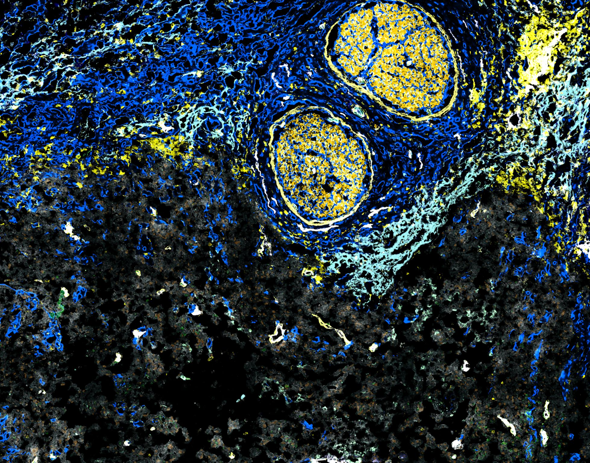
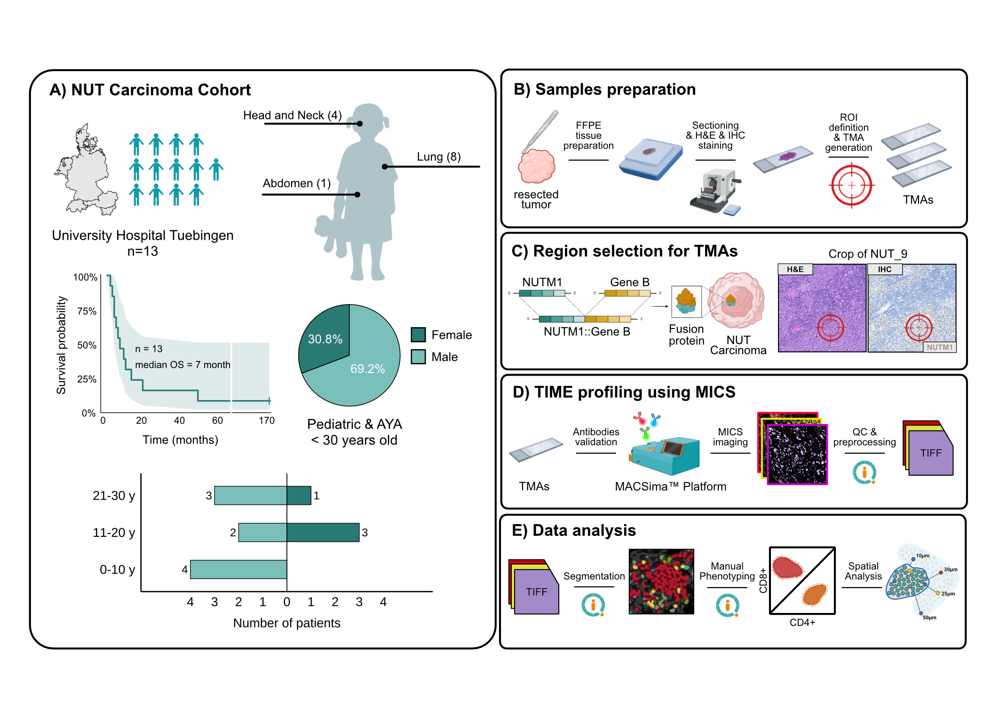

This repository consists of the preprocessing and downstream analysis scripts of the NUT Carcinoma MICS dataset, in collaboration between the Seitz and Schapiro groups at the Univeristy Hospital Tuebingen and University Hospital Heidelberg in Germany.




## Overview

This is, to our knowledge, the first spatial immune profiling study of NUT carcinoma. Using a 72-marker MICS panel across a 13-patient FFPE cohort, we characterize the tumor immune microenvironment (TIME), with a focus on:

- Immune cell composition and the immunosupressive phenotype
- Spatial niche organization (including first-reported TLS-like structures in NC) 
- MDSC–CD8⁺ T cell spatial neighor preference 
- The association of the spatial and non-spatial features with clinical outcome




## Data

Required MACSiQ-preprocessed data, metadata, and Anndata object that can be used for this analysis is deposited to Zenodo: https://doi.org/10.5281/zenodo.22806982 

If you have any data-related questions, please contact the corresponding authors for access.

## Reproducing the analysis

In order to reproduce the analysis, please copy this repo to your local machine and follow the environment and configuration instructions. 

```bash
git clone https://github.com/SchapiroLabor/NUT_spatial
```

Make sure you have [git](https://git-scm.com/install/) installed on your machine

You can also find below the order of the scripts.
Paper figures are generated in **`figures/`**

## System requirements

- **Operating system:** macOS (Apple Silicon, `osx-arm64`). The analysis was developed and tested on macOS with an Apple M-series chip. 
- **Hardware:** No non-standard hardware is required. A standard desktop or laptop is sufficient; ≥16 GB RAM is recommended for loading the full AnnData object and image-based analyses.
- **Software:** [git](https://git-scm.com/install/) and [pixi](https://pixi.sh). All other dependencies (Python, R and packages) are installed automatically by pixi.

## Environment

Analysis environments are managed with [pixi](https://pixi.sh), combining Python and R. Each analysis directory is a separate pixi workspace with its own `pixi.toml` (declared dependencies) and `pixi.lock` (exact resolved versions). Install the environment from within each directory:

```bash
cd preprocessing   # repeat for each module
pixi install
```

### Software versions

Exact versions used in the analysis (resolved in each `pixi.lock`):

| Module | Language | Key packages (version) |
|---|---|---|
| `preprocessing/` | Python 3.10.20 | scanpy 1.11.5, anndata 0.11.4, numpy 2.2.6, pandas 2.3.3, scipy 1.15.2, scikit-image 0.25.2, scikit-learn 1.7.2, tifffile 2025.5.10, natsort ≥8.4, matplotlib 3.10.9, seaborn 0.13.2 |
| `proportions/` | R 4.3.3 | tidyverse 2.0.0, ggplot2 3.5.2 |
| `niches_clustering/` | Python 3.10.20 | scimap 2.3.6, scanpy 1.11.5, anndata 0.10.9, numpy 1.26.4, pandas 2.3.3, scipy 1.12.0, scikit-learn 1.7.2 |
| `spatial_distance/` | Python 3.10.20 | squidpy 1.6.5, cellcharter 0.3.5, scanpy 1.11.5, anndata 0.11.4, numpy 1.26.4, pandas 2.3.3, scipy 1.15.2, scikit-image 0.25.2, statsmodels 0.14.6, napari 0.4.3 |
| `cozi/` | Python 3.10.20 | COZIpy 0.1.2, scanpy 1.11.5, anndata 0.11.4, numpy 2.2.6, pandas 2.3.3, scipy 1.15.2 |
| `survival_analysis/` | R 4.5.3 | survival 3.8-6, survminer 0.5.2, ComplexHeatmap 2.26.1, tidyverse 2.0.0, ggplot2 4.0.3, ggpubr 1.0.0, rstatix 1.0.0, circlize 0.4.18, patchwork 1.3.2 |
| `figures/` | R 4.5.3 / Python 3.10.20 | ComplexHeatmap 2.26.1, ggplot2 4.0.3, tidyverse 2.0.0, compositions 2.0-9, survival 3.8-6, survminer 0.5.2, rstatix 0.7.3, circlize 0.4.18, patchwork 1.3.2; scanpy 1.11.5, anndata 0.11.4, napari 0.4.19, scikit-learn 1.7.2, statsmodels 0.14.6 |

The complete list of dependencies, including all transitive packages, is in each module's `pixi.lock`.

## Configuration

All directory paths used across the pipeline (both Python and R scripts) are centralized in `config.yaml` at the repo root. Before running any part of the pipeline, **edit the paths in `config.yaml` to match your local machine or server** — no paths should be hardcoded elsewhere in the scripts.

```yaml
raw_dir: '/path/to/your/raw' #contain preprocessed macs iq data but not fully preprocessed
metadata_dir: '/path/to/your/metadata' #contains metadata
preprocessed_dir: '/path/to/your/preprocessed' # contains preprocessed data per ROI
results_dir: '/path/to/your/results' #results_dir contains anndata objects, generated tables, and figures folders
figure_1: "/path/to/your/results/figure_1" # contains figures 
```

Both the Python and R scripts read this same file, so you only need to update it in one place:

- **Python:** loaded via `yaml.safe_load(open("config.yaml"))`
- **R:** loaded via `yaml::read_yaml("config.yaml")`

Do not change folder names inside the scripts themselves — only the paths in `config.yaml` need to be adjusted to your setup.

## Pipeline

The analysis broadly follows this order:

1. **`preprocessing/`** — QC, marker normalization, construction of the unified `AnnData` object
2. **`proportions/`** — Cell type composition profiling (two-stage ROI → patient aggregation)
3. **`niches_clustering/`** — Spatial neighborhood clustering and biological neighborhood annotation 
4. **`spatial_distance/`** — Distance and tumor contour distance analyses
5. **`cozi/`** — Neighbor preference score using COZIpy (NEP)
6. **`survival_analysis/`** — Cox regression and Kaplan-Meier analyses linking spatial/compositional features to patient outcomes
7. **`figures/`** — Assembly of all manuscript and supplementary figures

## Manuscript

["TBD"]
